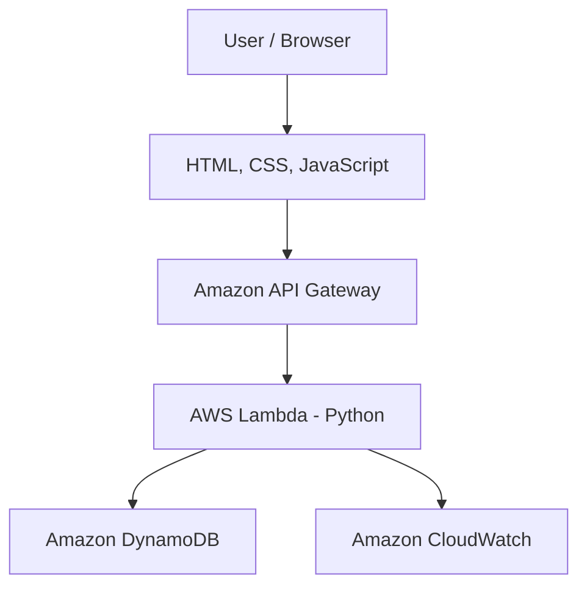

# ☁️ CloudTrack — AWS Serverless Job Application Tracker

A cloud-based job application tracking system built using **AWS Lambda, Amazon API Gateway, Amazon DynamoDB, Python, and JavaScript**.

CloudTrack helps users manage their job search by adding applications, tracking interview progress, updating application statuses, and monitoring their progress through a simple dashboard.

## 📸 Project Demo

### Application Dashboard


*Dashboard displaying job applications, interview counts, offers, and application status.*

### AWS Lambda Execution


*Successful Lambda test demonstrating backend execution.*

### API Gateway


*REST API configuration connecting HTTP requests to the Lambda function.*

### DynamoDB Database


*Job application records stored in Amazon DynamoDB.*

---

## ✨ Features

- **Add Applications:** Save company name, job role, application date, and status.
- **View Applications:** Retrieve saved records from the cloud database.
- **Edit Status:** Update application progress, such as Applied, Assessment, Interview, Rejected, or Selected.
- **Delete Applications:** Remove application records.
- **Dashboard Analytics:** Display total applications, interviews, and offers.
- **Persistent Storage:** Store application data in Amazon DynamoDB.
- **REST API Integration:** Communicate between the frontend and AWS backend.
- **Monitoring:** Use Amazon CloudWatch logs to troubleshoot Lambda execution.

## 🏗️ AWS Architecture



### Request Flow

1. The user adds, views, updates, or deletes a job application.
2. JavaScript sends an HTTP request to Amazon API Gateway.
3. API Gateway invokes the AWS Lambda function.
4. Lambda validates the request and performs the database operation.
5. Amazon DynamoDB stores or retrieves application records.
6. The API response updates the dashboard.

## 🛠️ Technology Stack

| Category | Technology |
|---|---|
| Frontend | HTML, CSS, JavaScript |
| Backend | Python |
| Serverless Compute | AWS Lambda |
| REST API | Amazon API Gateway |
| Database | Amazon DynamoDB |
| Monitoring | Amazon CloudWatch |
| Version Control | Git and GitHub |

## 🧪 Testing

The following workflows have been implemented:

- POST — Create a job application.
- GET — Retrieve applications for the demo user.
- PUT — Update an application's status.
- DELETE — Remove an application.

A successful POST request returned HTTP `201` with a generated application ID. GET was also tested to retrieve saved records.

Edit and Delete should be verified against the deployed API before claiming their tests as successful.

## 📂 Project Structure

```text
job-application-tracker/
├── frontend/
│   ├── index.html
│   ├── style.css
│   └── app.js
├── backend/
│   └── lambda_function.py
├── screenshots/
└── README.md
```

## 🚀 Local Setup

1. Clone this repository:

   ```bash
   git clone <YOUR_GITHUB_REPOSITORY_URL>
   ```

2. Open the project folder in Visual Studio Code.

3. Configure the API endpoint in `frontend/app.js` for your own deployment.

4. Open `frontend/index.html` using the Live Server extension.

5. Ensure the deployed API, Lambda function, DynamoDB table, and browser CORS configuration are working.

## 🔐 Security Considerations

- The current demo uses a shared `demo-user-1` identifier.
- Production deployment requires authentication and server-side user authorization.
- Never commit AWS access keys, secret keys, credentials, or sensitive environment files.
- Apply least-privilege IAM permissions.
- Review AWS usage and billing regularly.

## 🔮 Future Enhancements

- User registration and secure authentication.
- User-specific application access.
- Interview reminders and notifications.
- Search, filtering, and status-based analytics.
- Automated deployment using GitHub Actions.
- Improved responsive UI and dashboard visualizations.

## 👩‍💻 Author

**Priya Chauhan**

B.Tech — Computer Science and Engineering (AI & ML)

GitHub: <YOUR_GITHUB_PROFILE_URL>

---

*Built as a hands-on AWS serverless cloud computing project.*
